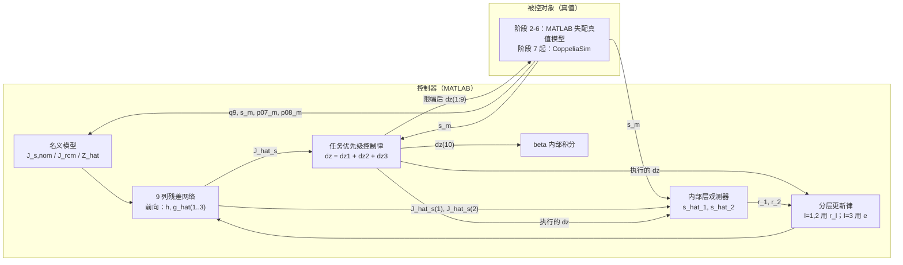

# 原理：基于 Lyapunov 稳定残差深度雅可比学习的"机械臂–连续体–内窥镜"视觉伺服

> **对象**：Franka Emika Panda（MDH 建模）＋ 法兰末端刚性杆 ＋ 单段连续体 ＋ 末端内窥镜相机，刚性杆受穿刺点（RCM）约束
> **目标**：在机械臂 MDH、连续体 PCC、相机内外参、目标深度均不精确的条件下，在线学习"10 维广义坐标 → 图像特征运动"的雅可比残差，实现图像特征轨迹跟踪，同时满足 RCM 约束
> **仿真**：MATLAB（控制器 + 失配真值模型）→ CoppeliaSim（最终真值）

---

## 0 推导主线

1. 建立名义耦合运动学，得到"10 维广义坐标 → 归一化图像坐标"的名义雅可比 $J_{s,\mathrm{nom}}$ 和 RCM 雅可比 $J_{rcm}$（第 3 节）。
2. 把真值雅可比写成"名义 + 残差"，残差按列用深度网络逼近（第 4 节）。
3. 证明两个引理：局部两层展开引理，以及一个统一的稳定性引理。凡是能写成"局部两层展开 + 有界扰动"形式的误差动态，都可以用同一形式的更新律保证有界与收敛（第 5 节）。
4. 内部层通过位置观测器、外部两层通过任务优先级控制器，各自得到满足统一引理的误差动态，从而得到全部更新律与闭环稳定性（第 6、7 节）。
5. 工程化处理（sat、区域误差、阻尼伪逆、离散化、限幅）与仿真搭建（第 8–11 节）。

---

## 1 问题描述与总体思路

### 1.1 系统组成

- 刚性部分：Panda 7 关节机械臂，法兰末端固连一根刚性杆，杆穿过固定在世界系中的套管穿刺点 $p_t$。
- 柔性部分：杆远端连接单段连续体，由弯曲平面角 $\phi$ 和弯曲角 $\theta$ 描述。
- 传感：连续体末端安装内窥镜相机，观测世界系中一个静止目标点。

### 1.2 为什么需要学习整机雅可比

名义运动学链为

$$
T_{09}=\underbrace{T_{07}(q_{DH})}_{\text{MDH 参数误差}}\;
\underbrace{T_{78}}_{\text{杆安装/杆长误差}}\;
\underbrace{T_{\mathrm{pcc}}(\phi,\theta)}_{\text{常曲率假设误差}}\;
\underbrace{T_c}_{\text{相机外参误差}}
$$

再叠加相机内参误差和目标深度误差。每一环的误差都会沿链传递并耦合，最终"关节 → 像素"的雅可比既没有准确的解析结构，也很难逐环标定。

### 1.3 总体思路

1. **残差学习**：$\hat J_s=J_{s,\mathrm{nom}}+\Delta\hat J_{NN}$。名义模型作为先验，网络只学习残差。网络输出层零初始化，使系统从名义模型起步，不需要离线数据集。
2. **分层在线学习**（参考方法）：内部层用"位置观测误差"学习，外部两层用"任务跟踪误差"学习，所有层同时在线更新。每一层的更新律都由 Lyapunov 分析得到。
3. **任务优先级**：RCM（主任务）> 图像跟踪（次任务）> 零空间（关节限位、奇异规避）。

### 1.4 与参考方法的对应关系

| 参考方法 | 本文 |
|---|---|
| 任务量 $x$ | 归一化图像坐标 $s=[x,y]^T$ |
| 关节量 $q\in\mathbb R^m$ | 广义坐标 $z\in\mathbb R^{10}$（学习前 9 列） |
| $\hat J=$ 深度网络 | $\hat J_s=J_{s,\mathrm{nom}}+$ 深度网络残差 |
| $\dot q=\hat J^\dagger\dot x_d-k_p\hat J^T\Delta x-k_s\hat J^\dagger\operatorname{sgn}(\Delta x)$ | 在投影雅可比 $\hat J_2=\hat J_sN_1$ 上的同形控制律 |
| 估计误差层（第 $1$ 至 $n-2$ 层） | $l=1,2$ |
| 跟踪误差层（最后两层） | $l=3$（$W_3$）及其输出 $W_4$ |
| 特征 $z_{lk}$ | 本文记为 $h_{lk}$（避免与广义坐标 $z$ 混淆） |
| 泄漏系数 $\beta_l$ | 本文记为 $\kappa_l$（避免与 RCM 参数 $\beta$ 混淆） |

---

## 2 符号与约定

| 符号 | 含义 | 维数 |
|---|---|---|
| $z=[q_{DH}^T,\ \phi,\ \theta,\ \beta]^T$ | 广义坐标 | $10$ |
| $q_{DH}$ | Panda 关节角 | $7$ |
| $q_c=[\phi,\theta]^T$ | 连续体弯曲平面角、弯曲角 | $2$ |
| $\beta$ | RCM 点在杆轴线上的插值参数（虚拟坐标） | $1$ |
| $s=[x,y]^T$ | 目标点归一化图像坐标（测量值） | $2$ |
| $s_d$ | 期望图像坐标 | $2$ |
| $e=s-s_d$ | 图像跟踪误差 | $2$ |
| $J_s$ | 真值图像雅可比（相对测量坐标） | $2\times10$ |
| $J_{s,\mathrm{nom}}$ | 名义图像雅可比 | $2\times10$ |
| $\hat J_s$ | 学习后的图像雅可比 | $2\times10$ |
| $J_{rcm}$ | 名义 RCM 雅可比 | $3\times10$ |
| $p_t$ | 穿刺点（世界系） | $3$ |
| $p_{07},\,p_{08}$ | 刚性杆近端、远端（远端即连续体基座） | $3$ |
| $e_{rcm}$ | RCM 误差 | $3$ |
| $L$ | 图像交互矩阵 | $2\times6$ |
| $S_k$ | 第 $k$ 列尺度 | 标量 |
| $v_k=S_k\dot z_k$ | 缩放后的第 $k$ 个广义速度 | 标量 |
| $\xi$ | 网络输入编码 | $11$ |
| $h_{lk}$ | 第 $k$ 分支第 $l$ 层特征 | $n_l$ |
| $\hat W_{lk}$ | 第 $k$ 分支第 $l$ 层权重 | $n_l\times n_{l-1}$ |
| $\hat G_{lk}$ | 第 $l$ 层对应的输出权重（$l=1,2$ 为辅助输出，$l=3$ 为最终输出 $W_4$） | $2\times n_l$ |
| $r_l$ | 第 $l$ 层观测误差 | $2$ |
| $\varepsilon_l$ | 第 $l$ 层学习误差（$\varepsilon_1=r_1,\ \varepsilon_2=r_2,\ \varepsilon_3=e$） | $2$ |

**约定**

- $[a]_\times$：向量 $a$ 的反对称矩阵，满足 $[a]_\times b=a\times b$。
- $A^+$：Moore–Penrose 伪逆。对行满秩矩阵，$A^+=A^T(AA^T)^{-1}$。
- $\operatorname{sgn}(\cdot)$、$\operatorname{sat}(\cdot)$：逐元素作用。
- $\|\cdot\|$：向量 2-范数、矩阵 Frobenius 范数；$\|\cdot\|_1$：向量 1-范数。
- 真值权重记为 $(\cdot)^\star$，估计误差记为 $\tilde{(\cdot)}=(\cdot)^\star-\hat{(\cdot)}$。
- 所有位置单位为米，角度单位为弧度，图像坐标使用归一化坐标（无量纲）。

---

## 3 耦合机器人运动学

### 3.1 广义坐标与自由度分析

$$
z=\begin{bmatrix}q_{DH}^T & \phi & \theta & \beta\end{bmatrix}^T\in\mathbb R^{10}
$$

- 前 9 维是物理关节，下发给机器人。
- $\beta$ 是虚拟坐标，只用于描述"杆轴线上哪一点与穿刺点重合"。$\dot\beta$ 在控制器内部积分，不下发。

**自由度计数**：$\dim z=10$，RCM 约束 3 个方程，可行运动空间 $10-3=7$ 维。

物理上对应为：杆绕穿刺点的 3 个转动 + 1 个插入（共 4 维），加上机械臂的 1 维自运动，再加上连续体 2 维弯曲，合计 7 维。单点图像任务占 2 维，余下 5 维零空间。

### 3.2 Panda MDH 正运动学与几何雅可比

Craig（MDH）约定下，相邻连杆变换为

$$
{}^{i-1}T_i=R_x(\alpha_{i-1})\,D_x(a_{i-1})\,R_z(\vartheta_i)\,D_z(d_i)=
\begin{bmatrix}
c\vartheta_i & -s\vartheta_i & 0 & a_{i-1}\\
s\vartheta_i c\alpha_{i-1} & c\vartheta_i c\alpha_{i-1} & -s\alpha_{i-1} & -d_i s\alpha_{i-1}\\
s\vartheta_i s\alpha_{i-1} & c\vartheta_i s\alpha_{i-1} & c\alpha_{i-1} & d_i c\alpha_{i-1}\\
0&0&0&1
\end{bmatrix}
$$

其中 $\vartheta_i=q_i+\vartheta_{0,i}$，$\vartheta_{0,i}$ 为关节零位偏置。这里用 $\vartheta$ 表示关节转角，以区别于连续体弯曲角 $\theta$。

$$
T_{07}=\prod_{i=1}^{7}{}^{i-1}T_i
$$

在 MDH 约定下，关节 $i$ 的转轴是坐标系 $i$ 的 $z$ 轴 $\hat z_i$，原点为 $o_i$。对任意固连在第 7 连杆上的点 $p$：

$$
J_P(p)=\begin{bmatrix}\hat z_1\times(p-o_1) & \cdots & \hat z_7\times(p-o_7)\end{bmatrix}\in\mathbb R^{3\times7},
\qquad
J_\Omega=\begin{bmatrix}\hat z_1&\cdots&\hat z_7\end{bmatrix}\in\mathbb R^{3\times7}
$$

### 3.3 刚性杆

$$
T_{08}=T_{07}\,T_{7F}\,T_m\,D_z(L_{sh})
$$

- $T_{7F}$：Panda 法兰偏置。
- $T_m$：杆安装变换（需标定，存在误差）。
- $L_{sh}$：杆长。
- 杆近端 $p_{07}$ 取 $T_{07}T_{7F}T_m$ 的平移部分，杆远端 $p_{08}$ 取 $T_{08}$ 的平移部分。
- 注意：文中沿用 $p_{07}$ 记号表示杆近端，它不一定等于 Panda MDH 第 7 坐标系原点。

对应的雅可比：

$$
J_7=J_P(p_{07}),\qquad J_8=J_P(p_{08}),\qquad
J_r=\begin{bmatrix}J_{r,p}\\ J_{r,\omega}\end{bmatrix}=\begin{bmatrix}J_P(p_{08})\\ J_\Omega\end{bmatrix}\in\mathbb R^{6\times7}
$$

### 3.4 连续体 PCC 运动学

柔性段长度为 $L_f$，常曲率假设下末端相对连续体基座（坐标系 8）的位姿为

$$
p_{\mathrm{pcc}}(\phi,\theta)=L_f\begin{bmatrix}a(\theta)\cos\phi\\ a(\theta)\sin\phi\\ b(\theta)\end{bmatrix},
\qquad
R_{\mathrm{pcc}}(\phi,\theta)=R_z(\phi)\,R_y(\theta)\,R_z(-\phi)
$$

$$
a(\theta)=\frac{1-\cos\theta}{\theta},\qquad b(\theta)=\frac{\sin\theta}{\theta}
$$

**位置雅可比**：直接对 $p_{\mathrm{pcc}}$ 求偏导，

$$
J_p=L_f\begin{bmatrix}
-a\sin\phi & a'\cos\phi\\
a\cos\phi & a'\sin\phi\\
0 & b'
\end{bmatrix},\qquad
a'=\frac{\theta\sin\theta-(1-\cos\theta)}{\theta^2},\quad
b'=\frac{\theta\cos\theta-\sin\theta}{\theta^2}
$$

**角速度雅可比**：对 $R=ABC$，有 $\omega=\omega_A+A\,\omega_B+AB\,\omega_C$。其中 $A=R_z(\phi)$ 贡献 $\hat e_z\dot\phi$，$B=R_y(\theta)$ 贡献 $R_z(\phi)\hat e_y\dot\theta$，$C=R_z(-\phi)$ 贡献 $-R_z(\phi)R_y(\theta)\hat e_z\dot\phi$。整理得

$$
J_\omega=\begin{bmatrix}
-\cos\phi\sin\theta & -\sin\phi\\
-\sin\phi\sin\theta & \cos\phi\\
1-\cos\theta & 0
\end{bmatrix}
$$

**小角度处理**：$|\theta|<10^{-3}$ 时，$a,b,a',b'$ 用泰勒展开计算（附录 A），避免 $0/0$。

### 3.5 相机相对连续体基座的雅可比 $J_{\mathrm{tool}}$

相机光学坐标系 9 相对末端的固定变换为 $T_c=\begin{bmatrix}R_c&p_c\\0&1\end{bmatrix}$，因此

$$
p_{89}=p_{\mathrm{pcc}}+R_{\mathrm{pcc}}\,p_c
$$

对时间求导：

$$
\dot p_{89}=J_p\dot q_c+\omega\times(R_{\mathrm{pcc}}p_c)=\big(J_p-[R_{\mathrm{pcc}}p_c]_\times J_\omega\big)\dot q_c
$$

于是得到在坐标系 8 中表达的相机相对速度雅可比：

$$
J_{\mathrm{tool}}=\begin{bmatrix}J_p-[R_{\mathrm{pcc}}p_c]_\times J_\omega\\ J_\omega\end{bmatrix}\in\mathbb R^{6\times2}
$$

说明：相机偏置 $p_c$ 使姿态误差被放大为位置误差，这是 PCC 误差在相机端的主要表现之一，不能省略。

### 3.6 相机在世界系下的速度与 $J_g$

刚体速度合成：

$$
v_9=v_8+\omega_8\times(p_{09}-p_{08})+R_{08}\,v_{9/8},\qquad
\omega_9=\omega_8+R_{08}\,\omega_{9/8}
$$

其中 $v_8=J_{r,p}\dot q_{DH}$，$\omega_8=J_{r,\omega}\dot q_{DH}$，$[v_{9/8};\omega_{9/8}]=J_{\mathrm{tool}}\dot q_c$。

利用 $\omega_8\times(p_{09}-p_{08})=[p_{08}-p_{09}]_\times\,\omega_8$，得到

$$
\begin{bmatrix}v_9\\ \omega_9\end{bmatrix}=
\underbrace{\begin{bmatrix}J_r+S_pJ_{r,\omega} & R_pJ_{\mathrm{tool}}\end{bmatrix}}_{J_g\in\mathbb R^{6\times9}}
\begin{bmatrix}\dot q_{DH}\\ \dot q_c\end{bmatrix}
$$

$$
S_p=\begin{bmatrix}[p_{08}-p_{09}]_\times\\ 0_{3\times3}\end{bmatrix},\qquad
R_p=\begin{bmatrix}R_{08}&0\\0&R_{08}\end{bmatrix}
$$

> 更正：原补充材料中 $S_p$ 与 $R_p$ 均写作 $R_p$，应以上式为准。

### 3.7 图像交互矩阵推导（归一化坐标）

目标点在世界系中静止于 $P_w$，在相机坐标系中为

$$
P=\begin{bmatrix}X\\Y\\Z\end{bmatrix}=R_{09}^T(P_w-p_{09})
$$

相机以 $({}^cv,{}^c\omega)$（相机系表达）运动，静止点在相机系中的运动为

$$
\dot P=-{}^cv-{}^c\omega\times P
$$

展开各分量：

$$
\dot X=-v_x-\omega_yZ+\omega_zY,\qquad
\dot Y=-v_y-\omega_zX+\omega_xZ,\qquad
\dot Z=-v_z-\omega_xY+\omega_yX
$$

归一化坐标 $x=X/Z$、$y=Y/Z$，有 $\dot x=\dot X/Z-x\dot Z/Z$。代入并整理：

$$
\dot x=-\frac{v_x}{Z}+\frac{x v_z}{Z}+xy\,\omega_x-(1+x^2)\,\omega_y+y\,\omega_z
$$

$$
\dot y=-\frac{v_y}{Z}+\frac{y v_z}{Z}+(1+y^2)\,\omega_x-xy\,\omega_y-x\,\omega_z
$$

即

$$
\dot s=L(x,y,Z)\begin{bmatrix}{}^cv\\ {}^c\omega\end{bmatrix},\qquad
L=\begin{bmatrix}
-\dfrac1Z & 0 & \dfrac xZ & xy & -(1+x^2) & y\\[6pt]
0 & -\dfrac1Z & \dfrac yZ & 1+y^2 & -xy & -x
\end{bmatrix}
$$

与像素形式的关系：记 $\bar u=u-c_u=fx$、$\bar v=v-c_v=fy$，则像素交互矩阵为 $L_{px}=fL$。代入后即为补充材料中的 $L_t,L_\omega$ 形式。

### 3.8 名义图像雅可比

相机系速度与世界系速度的关系为 ${}^cv=R_{09}^Tv_9$，${}^c\omega=R_{09}^T\omega_9$。因此

$$
J_{s,\mathrm{nom}}(z)=\begin{bmatrix}L(x_m,y_m,\hat Z)\,X\,J_g & 0_{2\times1}\end{bmatrix}\in\mathbb R^{2\times10},
\qquad X=\begin{bmatrix}R_{09}^T&0\\0&R_{09}^T\end{bmatrix}
$$

- $R_{09}$、$J_g$ 按名义参数计算。
- $L$ 中的 $x_m,y_m$ 使用测量值。
- 深度 $\hat Z=\hat e_3^T R_{09}^T(\hat P_w-p_{09})$ 由名义正运动学和名义目标位置 $\hat P_w$ 得到。
- 最后一列为 0：相机位姿与 $\beta$ 无关，这是结构性结论，与模型是否准确无关。

### 3.9 内参误差的作用

真实像素 $u=f_xx+c_u$，用名义内参换算得到的测量坐标为

$$
x_m=\frac{u-\hat c_u}{\hat f_x}=\gamma_x\,x+o_x,\qquad \gamma_x=\frac{f_x}{\hat f_x},\quad o_x=\frac{c_u-\hat c_u}{\hat f_x}
$$

$y$ 方向同理。因此 $\dot s_m=\Gamma\dot s$，$\Gamma=\operatorname{diag}(\gamma_x,\gamma_y)$。

结论：
- 内参误差等价于对真值雅可比做常数行缩放，外加 $L$ 的求值点偏差。两者都进入残差，由网络学习。
- 下文所说的"真值雅可比 $J_s$"指的是测量坐标 $s_m$ 对 $z$ 的雅可比。
- 像素误差与归一化误差的换算关系为 $e_{px}=\hat f\,e$（按名义焦距）。

### 3.10 RCM 雅可比与真实 RCM 误差

$$
p_{rcm}=p_{07}+\beta\,(p_{08}-p_{07}),\qquad e_{rcm}=p_{rcm}-p_t
$$

$$
\dot p_{rcm}=\big[J_7+\beta(J_8-J_7)\big]\dot q_{DH}+(p_{08}-p_{07})\dot\beta
$$

$$
J_{rcm}=\begin{bmatrix}J_7+\beta(J_8-J_7) & 0_{3\times2} & p_{08}-p_{07}\end{bmatrix}\in\mathbb R^{3\times10}
$$

**误差分解**：记杆轴单位向量 $\hat a=(p_{08}-p_{07})/\|p_{08}-p_{07}\|$，则

$$
e_{rcm}=\underbrace{(I-\hat a\hat a^T)(p_{07}-p_t)}_{e_\perp:\ \text{与}\ \beta\ \text{无关，物理约束}}+\underbrace{\hat a\hat a^T e_{rcm}}_{e_\parallel:\ \text{由}\ \beta\ \text{吸收}}
$$

真实 RCM 误差应以穿刺点到**真值**杆轴线的垂直距离 $d_\perp=\|e_\perp\|$ 衡量。$e_\parallel$ 只反映 $\beta$ 与插入深度是否一致。

**两种 RCM 误差来源**
- 名义：$p_{07},p_{08}$ 按名义正运动学计算。反馈只能把名义误差压到 0，真实误差仍残留一个等于"RCM 点正运动学误差"的静态偏差。
- 测量：$p_{07},p_{08}$ 取真值（仿真中可直接读取；真实系统需要杆位姿跟踪或套管端传感）。

初始化时取 $\beta_0=\dfrac{(p_t-p_{07})^T(p_{08}-p_{07})}{\|p_{08}-p_{07}\|^2}$，使初始 $e_\parallel=0$。

### 3.11 奇异性分析

1. **连续体直线构型**：当 $\theta\to0$ 时，$a\to0$ 且 $\omega_\phi\to0$，$J_{\mathrm{tool}}$ 的 $\phi$ 列整体趋于 0，$\phi$ 失去定义。在耦合系统中，机械臂列通常仍能使 $J_s$ 保持行满秩，但 $\phi$ 列的学习信号消失，输入编码也退化。因此限定 $\theta\ge\theta_{\min}$（建议约 0.15 rad），并在零空间中加入远离 $\theta_{\min}$ 的代价项。
2. **RCM 雅可比**：由于 $p_{08}\ne p_{07}$，$\beta$ 列恒非零，一般构型下 $J_{rcm}$ 行满秩。
3. **投影后的图像雅可比**：$\hat J_2=\hat J_sN_1$ 的最小奇异值 $\sigma_{\min}(\hat J_2)$ 需要在线监测（第 8.3 节）。

---

## 4 残差深度雅可比模型

### 4.1 残差分解与列结构

$$
J_s(z)=J_{s,\mathrm{nom}}(z)+\Delta J(z),\qquad
\Delta J=\begin{bmatrix}\Delta j_1&\cdots&\Delta j_9&0\end{bmatrix}
$$

- 第 10 列（$\beta$）在真值和名义中都恒为 0，所以残差也恒为 0，不参与学习。
- 目标静止时（假设 A2），测量 $s_m$ 由 $z$ 唯一确定，$J_{s,\mathrm{nom}}(z,s_m(z))$ 也就是 $z$ 的函数，因此残差 $\Delta J$ 只依赖 $z$。

按列展开，真值运动学可写为

$$
\dot s=J_{s,\mathrm{nom}}\dot z+\sum_{k=1}^{9}\Delta j_k(z)\,\dot z_k
$$

### 4.2 列尺度归一化

不同列的量级相差很大：基座关节力臂长，对应列大；连续体列相对较小。为此引入固定列尺度 $S_k$（取工作空间内 $\|j_{\mathrm{nom},k}\|$ 的中位数，离线计算一次后固定）：

$$
\Delta j_k=S_k\,g_k(\xi),\qquad v_k=S_k\dot z_k
\quad\Longrightarrow\quad
\dot s=J_{s,\mathrm{nom}}\dot z+\sum_{k=1}^{9}g_k(\xi)\,v_k
$$

这样网络学习的是无量纲残差 $g_k$，同一组增益可以同时适用于 9 列。**实现时把 $S_k$ 并入速度，更新律形式不变。**

### 4.3 网络输入编码

$$
\xi=\begin{bmatrix}(q_{DH}-q_{\mathrm{mid}})\oslash q_{\mathrm{half}}\\ \sin\phi\\ \cos\phi\\ \theta/\theta_s\\ 1\end{bmatrix}\in\mathbb R^{11}
$$

- $q_{\mathrm{mid}}$、$q_{\mathrm{half}}$ 为各关节限位的中点和半幅，$\oslash$ 表示逐元素相除。
- $\theta_s$ 为最大弯曲角。
- 常数 1 相当于第一层的偏置。
- 不含 $\beta$：相机与 $\beta$ 无关。

### 4.4 网络结构与前向传播

每个学习列 $k\in\{1,\dots,9\}$ 使用一个分支，结构为 $11\to32\to32\to16\to2$，隐藏层 $\tanh$，输出层线性：

$$
h_{0k}=\xi,\qquad h_{lk}=\tanh(\hat W_{lk}h_{l-1,k}),\quad l=1,2,3
$$

$$
\hat g_k^{(l)}=\hat G_{lk}h_{lk},\quad l=1,2,3
$$

- $l=1,2$：$\hat G_{lk}$ 为辅助输出权重（参考方法中的 $W^o_{lk}$），只用于观测器，不进入控制器。
- $l=3$：$\hat G_{3k}$ 即最终输出层 $\hat W_{4k}$，**不是额外的第五层**。

各层对应的雅可比估计为

$$
\hat J_s^{(l)}=J_{s,\mathrm{nom}}+\begin{bmatrix}S_1\hat g_1^{(l)}&\cdots&S_9\hat g_9^{(l)}&0\end{bmatrix},\qquad \hat J_s\equiv\hat J_s^{(3)}
$$

定义逐层的速度特征与敏感度矩阵（$\tanh'=1-\tanh^2$）：

$$
\hat\Phi_{lk}=h_{lk}\,v_k\in\mathbb R^{n_l},\qquad
\hat\Phi'_{lk}=v_k\operatorname{diag}\!\big(1-h_{lk}\odot h_{lk}\big)\in\mathbb R^{n_l\times n_l}
$$

| 参数（每分支） | 维数 | 作用 |
|---|---|---|
| $\hat W_{1k}$ | $32\times11$ | 第 1 隐藏层（估计误差层） |
| $\hat W_{2k}$ | $32\times32$ | 第 2 隐藏层（估计误差层） |
| $\hat W_{3k}$ | $16\times32$ | 最后隐藏层（跟踪误差层） |
| $\hat G_{3k}=\hat W_{4k}$ | $2\times16$ | 最终输出（跟踪误差层） |
| $\hat G_{1k},\hat G_{2k}$ | $2\times32$ | 辅助输出 |

每分支 2048 个参数，9 个分支共 18432 个。

### 4.5 初始化

- $\hat W_{1k},\hat W_{2k},\hat W_{3k}$：Xavier 小随机值。
- $\hat G_{lk}=0$（$l=1,2,3$）。

由此 $t=0$ 时 $\hat J_s^{(l)}=J_{s,\mathrm{nom}}$，系统从名义模型起步。

初始时刻，由于 $\hat G=0$，所有隐藏层更新律的第一项都为 0，最先变化的是输出权重 $\hat G$；随后隐藏层才开始更新。这属于正常现象。

### 4.6 假设

- **A1（紧工作集）**：运动限制在紧集 $\Omega$ 内，包括关节限位、$\theta\in[\theta_{\min},\theta_{\max}]$、目标始终在视野内且 $Z\ge Z_{\min}>0$。$\Delta J$ 在 $\Omega$ 上光滑。
- **A2（静止目标）**：目标点在世界系中静止。
- **A3（特征条件逼近）**：对每列 $k$、每层 $l\in\{1,2,3\}$，存在常值理想权重 $W^\star_{lk},G^\star_{lk}$，满足 $\|W^\star_{lk}\|\le\bar W$、$\|G^\star_{lk}\|\le\bar G$，使得在 $\Omega$ 上
  $$g_k(\xi)=G^\star_{lk}\,\sigma\!\big(W^\star_{lk}h_{l-1,k}\big)+\eta_{lk},\qquad \|\eta_{lk}\|\le\bar\eta_l$$
  即以当前（有界的）上一层特征为输入的两层网络能够逼近残差。这是该类分层方法的共同假设，也是理论上最薄弱的一环（见第 12 节）。
- **A4（速度有界）**：$\|\dot z\|\le\bar{\dot z}$，因而 $|v_k|\le\bar v$。由速度限幅保证，分析中假设限幅不被激活。
- **A5（秩条件）**：沿轨迹 $\sigma_{\min}(J_{rcm})\ge\sigma_r>0$，$\sigma_{\min}(\hat J_2)\ge\sigma_0>0$。
- **A6（期望轨迹）**：$s_d,\dot s_d$ 有界，且在视野内可行。

---

## 5 局部两层展开与统一引理

### 5.1 引理 1（局部两层展开）

对某一层 $l$ 和某一列 $k$（下标省略），记输入特征为 $h$（即 $h_{l-1,k}$），理想网络为 $G^\star\sigma(W^\star h)$，估计网络为 $\hat G\sigma(\hat Wh)$。令 $\hat\sigma=\sigma(\hat Wh)$，$\hat\sigma'=\operatorname{diag}(\sigma'(\hat Wh))$，则

$$
\big[G^\star\sigma(W^\star h)-\hat G\sigma(\hat Wh)\big]v
=\tilde G\big(\hat\Phi-\hat\Phi'\hat Wh\big)+\hat G\hat\Phi'\tilde Wh+\varpi\,v
$$

其中 $\hat\Phi=\hat\sigma v$，$\hat\Phi'=\hat\sigma'v$，余项满足

$$
\|\varpi\|\le2\sqrt{n_l}\,\bar G+\bar h\big(\bar W\|\tilde G\|+\bar G\|\tilde W\|\big)
$$

$\bar h$ 为 $\|h\|$ 的上界：$l=1$ 时取 $\max\|\xi\|$，$l\ge2$ 时取 $\sqrt{n_{l-1}}$（因为 $\tanh$ 有界）。

**推导**

在 $\hat Wh$ 处做泰勒展开：

$$
\sigma(W^\star h)=\hat\sigma+\hat\sigma'\tilde Wh+O,\qquad O=\sigma(W^\star h)-\hat\sigma-\hat\sigma'\tilde Wh
$$

于是

$$
G^\star\sigma(W^\star h)-\hat G\hat\sigma
=(\hat G+\tilde G)(\hat\sigma+\hat\sigma'\tilde Wh+O)-\hat G\hat\sigma
=\tilde G\hat\sigma+\hat G\hat\sigma'\tilde Wh+\tilde G\hat\sigma'\tilde Wh+G^\star O
$$

再把 $\tilde G\hat\sigma'\tilde Wh$ 拆开：$\tilde G\hat\sigma'\tilde Wh=\tilde G\hat\sigma'W^\star h-\tilde G\hat\sigma'\hat Wh$。代回得

$$
=\tilde G(\hat\sigma-\hat\sigma'\hat Wh)+\hat G\hat\sigma'\tilde Wh+\underbrace{\tilde G\hat\sigma'W^\star h+G^\star O}_{\varpi}
$$

两边乘以标量 $v$ 即得结论。

余项界：由于 $|\tanh'|\le1$，$\|\sigma(a)-\sigma(b)\|\le2\sqrt{n_l}$，有 $\|O\|\le2\sqrt{n_l}+\|\tilde W\|\bar h$，从而得到上面的界。$\square$

**意义**：误差被拆成"对 $\tilde G$ 线性"和"对 $\tilde W$ 线性"两项，这正是设计两组更新律、并在 Lyapunov 导数中逐项抵消的依据。

### 5.2 引理 2（统一稳定性引理）

考虑误差系统（Filippov 意义下的解）：

$$
\dot\varepsilon=\sum_{k=1}^{9}\Big[\tilde G_k\big(\hat\Phi_k-\hat\Phi'_k\hat W_kh_k\big)+\hat G_k\hat\Phi'_k\tilde W_kh_k\Big]+\delta-K(t)\,\varepsilon-K_s\operatorname{sgn}(\varepsilon)
$$

其中：
- $K(t)$ 对称、有界，且 $K(t)\ge\kappa_0I$，$\kappa_0\ge0$。
- $K_s>0$。
- 扰动满足 $\|\delta\|\le D_0+D_1\|\tilde\Theta\|$，$\tilde\Theta$ 为全部 $\tilde W_k,\tilde G_k$ 的堆叠。

采用更新律

$$
\boxed{\dot{\hat W}_k=\alpha\,\hat\Phi_k'^{T}\hat G_k^{T}\varepsilon\,h_k^{T}-\alpha\kappa\|\varepsilon\|\hat W_k}
$$

$$
\boxed{\dot{\hat G}_k=\alpha^G\varepsilon\big(\hat\Phi_k^{T}-h_k^{T}\hat W_k^{T}\hat\Phi_k'^{T}\big)-\alpha^G\kappa^G\|\varepsilon\|\hat G_k}
$$

记 $\mu=\min(\kappa,\kappa^G)$，$\nu=\max(\kappa,\kappa^G)$，$\bar\Theta=\sqrt{9(\bar W^2+\bar G^2)}$。若

$$
K_s\ \ge\ D_0+\frac{(\nu\bar\Theta+D_1)^2}{4\mu}+\gamma,\qquad \gamma>0
$$

则 $\varepsilon,\hat W_k,\hat G_k$ 有界，且 $\varepsilon(t)\to0$。

**证明**

取

$$
V=\frac12\varepsilon^T\varepsilon+\sum_{k=1}^{9}\Big[\frac1{2\alpha}\operatorname{tr}(\tilde W_k^T\tilde W_k)+\frac1{2\alpha^G}\operatorname{tr}(\tilde G_k^T\tilde G_k)\Big]
$$

理想权重为常数，故 $\dot{\tilde W}=-\dot{\hat W}$，$\dot{\tilde G}=-\dot{\hat G}$。

(1) 误差项与学习项的抵消。利用 $a^TMb=\operatorname{tr}(M^Tab^T)$ 型恒等式：

$$
\varepsilon^T\tilde G_k(\hat\Phi_k-\hat\Phi'_k\hat W_kh_k)=\operatorname{tr}\!\Big(\tilde G_k^T\,\varepsilon\big(\hat\Phi_k^T-h_k^T\hat W_k^T\hat\Phi_k'^T\big)\Big)
$$

$$
\varepsilon^T\hat G_k\hat\Phi'_k\tilde W_kh_k=\operatorname{tr}\!\Big(\tilde W_k^T\,\hat\Phi_k'^T\hat G_k^T\varepsilon h_k^T\Big)
$$

它们分别与 $-\frac1{\alpha^G}\operatorname{tr}(\tilde G_k^T\dot{\hat G}_k)$、$-\frac1\alpha\operatorname{tr}(\tilde W_k^T\dot{\hat W}_k)$ 中的第一项完全抵消。

(2) 泄漏项。$\frac1\alpha\operatorname{tr}\big(\tilde W_k^T\alpha\kappa\|\varepsilon\|\hat W_k\big)=\kappa\|\varepsilon\|\operatorname{tr}(\tilde W_k^T\hat W_k)$，且

$$
\operatorname{tr}(\tilde W_k^T\hat W_k)=\operatorname{tr}\big(\tilde W_k^T(W_k^\star-\tilde W_k)\big)\le\|\tilde W_k\|\bar W-\|\tilde W_k\|^2
$$

$\tilde G_k$ 同理。对 9 个分支求和并用 Cauchy–Schwarz 不等式，泄漏项总贡献不超过 $\|\varepsilon\|\big(\nu\bar\Theta\|\tilde\Theta\|-\mu\|\tilde\Theta\|^2\big)$。

(3) 合并。由于 $\varepsilon^T\operatorname{sgn}(\varepsilon)=\|\varepsilon\|_1\ge\|\varepsilon\|$，

$$
\dot V\le-\varepsilon^TK\varepsilon-\|\varepsilon\|\Big[K_s-D_0-(\nu\bar\Theta+D_1)\|\tilde\Theta\|+\mu\|\tilde\Theta\|^2\Big]
$$

方括号中关于 $\|\tilde\Theta\|$ 的二次式最小值为 $K_s-D_0-\frac{(\nu\bar\Theta+D_1)^2}{4\mu}\ge\gamma$，所以

$$
\dot V\le-\kappa_0\|\varepsilon\|^2-\gamma\|\varepsilon\|\le0
$$

(4) 结论。$V$ 不增，故 $\varepsilon,\tilde W_k,\tilde G_k$ 有界；又 $\int_0^\infty\|\varepsilon\|\,dt\le V(0)/\gamma<\infty$，而方程右端各项有界，所以 $\dot\varepsilon$ 有界、$\|\varepsilon\|$ 一致连续。由 Barbalat 引理得 $\varepsilon\to0$。$\square$

**注**
- 该引理不要求 $\kappa_0>0$：即使 $K$ 只是半正定，$\gamma$ 项也能保证收敛。
- 引理给出的 $K_s$ 条件偏保守，实际整定从小值起步（第 11 节）。

---

## 6 估计误差层：观测器与更新律

### 6.1 观测器

对内部层 $l=1,2$，构造图像特征观测器：

$$
\dot{\hat s}_l=\hat J_s^{(l)}\dot z+K_{pl}\,r_l+K_{sl}\operatorname{sgn}(r_l),\qquad r_l=s_m-\hat s_l,\qquad \hat s_l(0)=s_m(0)
$$

其中 $\hat J_s^{(l)}\dot z=J_{s,\mathrm{nom}}\dot z+\sum_k\hat G_{lk}\hat\Phi_{lk}$。

### 6.2 误差动态

$$
\dot r_l=\dot s_m-\dot{\hat s}_l
=\underbrace{J_{s,\mathrm{nom}}\dot z-J_{s,\mathrm{nom}}\dot z}_{=0}+\sum_{k}\big(g_k-\hat G_{lk}h_{lk}\big)v_k-K_{pl}r_l-K_{sl}\operatorname{sgn}(r_l)
$$

由 A3，$g_k=G^\star_{lk}\sigma(W^\star_{lk}h_{l-1,k})+\eta_{lk}$，再应用引理 1：

$$
\dot r_l=\sum_k\Big[\tilde G_{lk}\big(\hat\Phi_{lk}-\hat\Phi'_{lk}\hat W_{lk}h_{l-1,k}\big)+\hat G_{lk}\hat\Phi'_{lk}\tilde W_{lk}h_{l-1,k}\Big]+\delta_l-K_{pl}r_l-K_{sl}\operatorname{sgn}(r_l)
$$

$$
\delta_l=\sum_k(\eta_{lk}+\varpi_{lk})\,v_k,\qquad
\|\delta_l\|\le\underbrace{9\bar v(\bar\eta_l+2\sqrt{n_l}\bar G)}_{D_0^{(l)}}+\underbrace{\sqrt{18}\,\bar v\bar h\max(\bar W,\bar G)}_{D_1^{(l)}}\|\tilde\Theta_l\|
$$

这正是引理 2 的形式，其中 $K=K_{pl}I$，$K_s=K_{sl}$。

### 6.3 更新律（$l=1,2$）

$$
\dot{\hat W}_{lk}=\alpha_l\hat\Phi_{lk}'^{T}\hat G_{lk}^{T}r_l\,h_{l-1,k}^{T}-\alpha_l\kappa_l\|r_l\|\hat W_{lk}
$$

$$
\dot{\hat G}_{lk}=\alpha_l^G r_l\big(\hat\Phi_{lk}^{T}-h_{l-1,k}^{T}\hat W_{lk}^{T}\hat\Phi_{lk}'^{T}\big)-\alpha_l^G\kappa_l^G\|r_l\|\hat G_{lk}
$$

### 6.4 说明

1. **名义项严格抵消**：残差结构不改变误差动态的形式，而且逼近对象从 $J_s$ 变为更小、更平滑的 $\Delta J$，$\bar\eta$ 更小，所需 $K_{sl}$ 更小，抖振也更小。
2. **内部层的学习信号与控制器无关**：只要 $\dot z\neq0$ 且残差非零，$r_l$ 就会被激励，包括零空间自运动。因此内部层可以从全部实际运动中学习，不需要等待跟踪误差反向传播。
3. **观测器是纯软件状态**：初值取测量值，$r_l(0)=0$。

---

## 7 任务优先级控制律与跟踪误差层

### 7.1 RCM 主任务

$$
\dot z_1=-J_{rcm}^+K_{rcm}\,e_{rcm},\qquad N_1=I_{10}-J_{rcm}^+J_{rcm}
$$

真值 RCM 误差动态为 $\dot e_{rcm}=J_{rcm,\mathrm{true}}\dot z=(J_{rcm}+\Delta J_{rcm})\dot z$。由于后续 $\dot z_2,\dot z_3\in\mathcal R(N_1)$，有 $J_{rcm}(\dot z_2+\dot z_3)=0$；又 $J_{rcm}J_{rcm}^+=I$（A5），所以

$$
\dot e_{rcm}=-K_{rcm}e_{rcm}+\Delta J_{rcm}\dot z
$$

取 $V_{rcm}=\frac12\|e_{rcm}\|^2$，得 $\dot V_{rcm}\le-K_{rcm}\|e_{rcm}\|^2+\|e_{rcm}\|\bar\Delta_{rcm}\bar{\dot z}$。因此 RCM 误差一致最终有界：

$$
\limsup_{t\to\infty}\|e_{rcm}\|\le\frac{\bar\Delta_{rcm}\,\bar{\dot z}}{K_{rcm}}
$$

这给出 $K_{rcm}$ 的选取依据：MDH 误差越大、运动越快，所需 $K_{rcm}$ 越大。

> 注意：若 $e_{rcm}$ 按名义正运动学计算，反馈只能消除名义误差，真实误差 $d_\perp$ 中残留的静态偏差无法由反馈消除。

### 7.2 图像次任务

$$
\hat J_2=\hat J_sN_1
$$

$$
\boxed{\dot z_2=\hat J_2^+\big(\dot s_d-\hat J_s\dot z_1\big)-k_p\hat J_2^Te-k_s\hat J_2^+\operatorname{sgn}(e)}
$$

零空间任务：

$$
\dot z_3=N_{12}\big(-k_0\nabla H(z)\big),\qquad N_{12}=I_{10}-J_a^+J_a,\qquad J_a=\begin{bmatrix}J_{rcm}\\ \hat J_s\end{bmatrix}
$$

总控制量：

$$
\dot z=\dot z_1+\dot z_2+\dot z_3
$$

前 9 维下发，$\beta$ 在控制器内积分：$\beta_{k+1}=\beta_k+T_s\dot z_{10}$。

与参考控制律相比，唯一的变化是：$\hat J$ 换成投影雅可比 $\hat J_2$，前馈中扣除了 RCM 修正运动引起的图像运动 $\hat J_s\dot z_1$。

### 7.3 误差动态推导

**投影恒等式**：设 $N$ 对称幂等，$AN$ 行满秩，则

$$
(AN)^+=(AN)^T\big(AN(AN)^T\big)^{-1}=NA^T\big(ANA^T\big)^{-1}
$$

所以 $(AN)^+$ 和 $(AN)^T$ 的值域都在 $\mathcal R(N)$ 中，从而 $N\dot z_2=\dot z_2$，进而

$$
\hat J_s\dot z_2=\hat J_sN_1\dot z_2=\hat J_2\dot z_2
=\dot s_d-\hat J_s\dot z_1-k_p\hat J_2\hat J_2^Te-k_s\operatorname{sgn}(e)
$$

这里用到了 $\hat J_2\hat J_2^+=I$（A5）。又 $\dot z_3\in\mathcal N(J_a)$，所以 $\hat J_s\dot z_3=0$。

**跟踪误差**：

$$
\dot e=J_s\dot z-\dot s_d=\hat J_s\dot z+(J_s-\hat J_s)\dot z-\dot s_d
$$

$$
\hat J_s\dot z=\hat J_s\dot z_1+\hat J_s\dot z_2+\hat J_s\dot z_3=\dot s_d-k_p\hat J_2\hat J_2^Te-k_s\operatorname{sgn}(e)
$$

$$
(J_s-\hat J_s)\dot z=\sum_{k=1}^{9}\big(g_k-\hat G_{3k}h_{3k}\big)v_k
$$

对后者应用 A3（$l=3$）和引理 1，得到

$$
\boxed{\dot e=\sum_k\Big[\tilde G_{3k}\big(\hat\Phi_{3k}-\hat\Phi'_{3k}\hat W_{3k}h_{2k}\big)+\hat G_{3k}\hat\Phi'_{3k}\tilde W_{3k}h_{2k}\Big]+\delta_3-k_p\hat J_2\hat J_2^Te-k_s\operatorname{sgn}(e)}
$$

这与参考方法的误差动态同形，满足引理 2，其中 $K=k_p\hat J_2\hat J_2^T\ge k_p\sigma_0^2I$，$K_s=k_s$。

**关键点**：$\delta_3$ 包含全部实际执行的 $\dot z$（包括 $\dot z_1$、$\dot z_3$）。学习是沿**所有实际执行方向**进行的，这正是需要把 $\hat J_s\dot z_1$ 放入前馈、把 $\dot z_3$ 投影到 $\hat J_s$ 零空间的原因。

### 7.4 跟踪误差层更新律（$l=3$）

$$
\dot{\hat W}_{3k}=\alpha_3\hat\Phi_{3k}'^{T}\hat G_{3k}^{T}e\,h_{2k}^{T}-\alpha_3\kappa_3\|e\|\hat W_{3k}
$$

$$
\dot{\hat G}_{3k}=\alpha_3^G e\big(\hat\Phi_{3k}^{T}-h_{2k}^{T}\hat W_{3k}^{T}\hat\Phi_{3k}'^{T}\big)-\alpha_3^G\kappa_3^G\|e\|\hat G_{3k}
$$

与参考方法对应：$\hat W_{3k}\leftrightarrow\hat W_{n-1,k}$，$\hat G_{3k}\leftrightarrow\hat W_{nk}$。误差符号统一取 $e=s_m-s_d$（与参考方法 $\Delta x=x-x_d$ 一致）。

### 7.5 闭环稳定性定理

**定理**：在 A1–A6 下，若对 $l=1,2,3$ 分别满足

$$
K_{sl}\ge D_0^{(l)}+\frac{(\nu_l\bar\Theta+D_1^{(l)})^2}{4\mu_l}+\gamma_l
$$

（$l=3$ 时 $K_{s3}=k_s$），则：
1. 所有权重、观测器状态、误差有界；
2. $r_1,r_2,e\to0$；
3. RCM 误差一致最终有界，界为 $\bar\Delta_{rcm}\bar{\dot z}/K_{rcm}$。

**证明要点**：取 $V=V_1+V_2+V_3$，$V_l$ 为引理 2 中以 $\varepsilon_l$ 构造的函数。

- $\tanh$ 特征有界，所以某一层权重的变化只通过 $h_{l-1,k}$ 进入其他层，而 $h_{l-1,k}$ 有界，其影响已包含在 A3 的逼近界中。因此三个子系统可以分别应用引理 2，得到 $\dot V_l\le-\kappa_{0,l}\|\varepsilon_l\|^2-\gamma_l\|\varepsilon_l\|$。
- **"所有层同时更新"不破坏稳定性**。
- RCM 回路由 7.1 节单独给出。$\square$

### 7.6 结论解读

1. **跟踪收敛不等于参数收敛**：$e\to0$ 并不意味着 $\hat J_s\to J_s$。在冗余系统中，未被执行的方向本来就无法辨识。
2. **方向一致性**：用 $\operatorname{sat}$ 代替 $\operatorname{sgn}$ 且信号光滑时，由 $r_l\to0$、$\dot r_l\to0$ 可得 $(J_s-\hat J_s^{(l)})\dot z\to0$，即辅助雅可比沿执行方向无偏。因此评价时应同时看方向误差 $\|(\hat J_s-J_s)\dot z\|/\|J_s\dot z\|$。
3. **内部层的价值**：内部层不依赖跟踪误差的反向传播就能获得学习信号，并通过改善特征 $h_{2k}$ 减小 $\bar\eta_3$，从而降低对 $k_s$ 的要求。
4. **泄漏项**：与 $\|\varepsilon\|$ 成正比，误差趋于 0 时自动消失，不会造成稳态偏差；但测量噪声下 $\|\varepsilon\|$ 不为 0，需要配合区域误差（8.2 节）。
5. **残差结构的收益**：$\bar\eta$ 小，所需 $k_s$ 小，抖振小；且 $t=0$ 时性能不低于名义模型。

---

## 8 工程化扩展

### 8.1 用 sat 替代 sgn

$$
\operatorname{sat}(\varepsilon_i)=\begin{cases}\sin\!\Big(\dfrac{\pi}{2a_i}\varepsilon_i\Big),&|\varepsilon_i|<a_i\\[6pt]\operatorname{sgn}(\varepsilon_i),&\text{其他}\end{cases}
$$

在边界层外与 $\operatorname{sgn}$ 一致，引理 2 的结论不变；在边界层内鲁棒项减弱。因此结论由"渐近收敛"变为"一致最终有界"，最终误差界随 $a_i$ 减小、$K$ 增大而减小。

### 8.2 区域误差

定义区域势函数

$$
P_i(e_i)=\frac{b_i^2}{2N}\max\!\Big(0,\frac{e_i^2}{b_i^2}-1\Big)^N,\qquad N\ge2
$$

其梯度为

$$
\Delta\xi_i=\frac{\partial P_i}{\partial e_i}=\max\!\Big(0,\frac{e_i^2}{b_i^2}-1\Big)^{N-1}e_i
$$

取 $V_3=\sum_iP_i(e_i)+(\text{权重项})$，则 $\dot V_3=\Delta\xi^T\dot e+\cdots$。在控制律和第 3 层更新律中用 $\Delta\xi$ 替代 $e$，引理 2 的推导逐项成立（$\Delta\xi^T\operatorname{sgn}(\Delta\xi)=\|\Delta\xi\|_1$）。结论为 $\Delta\xi\to0$，即 $|e_i|\le b_i$。

区域内反馈和学习都停止，可以抑制噪声驱动的权重漂移。$b_i$ 取可接受的像素容差除以 $\hat f$。

### 8.3 阻尼伪逆与奇异规避

$$
A^+_\lambda=A^T(AA^T+\lambda^2I)^{-1},\qquad
\lambda^2=\begin{cases}\lambda_0^2\big(1-(\sigma_{\min}/\epsilon)^2\big),&\sigma_{\min}<\epsilon\\ 0,&\text{其他}\end{cases}
$$

使用阻尼时 $\hat J_2\hat J_{2,\lambda}^+=I-\lambda^2(\hat J_2\hat J_2^T+\lambda^2I)^{-1}$。误差动态中多出一项有界扰动，远离奇异时该项为 0。

零空间代价函数建议取

$$
H(z)=\frac12\sum_{i=1}^{7}w_i\Big(\frac{q_i-q_{\mathrm{mid},i}}{q_{\max,i}-q_{\min,i}}\Big)^2+\frac12w_\theta\max(0,\theta_c-\theta)^2
$$

其中 $\theta_c$ 略大于 $\theta_{\min}$。计算 $N_1$、$N_{12}$ 时用精确伪逆，只在求解任务速度时使用阻尼伪逆。

### 8.4 离散化与采样条件

所有微分方程均用前向欧拉积分：$x_{k+1}=x_k+T_s\dot x_k$。

在 sat 的线性区，$\operatorname{sat}(\varepsilon)\approx\frac{\pi}{2a}\varepsilon$，标量误差的离散递推为 $\varepsilon_{k+1}=\big[1-T_s(K+\frac{\pi K_s}{2a})\big]\varepsilon_k$。稳定条件为 $0<T_s(K+\frac{\pi K_s}{2a})<2$，**为避免振荡，建议 $\le0.5$**：

$$
\text{观测器：}\ T_s\Big(K_{pl}+\frac{\pi K_{sl}}{2a_{o,l}}\Big)\le0.5,\qquad
\text{跟踪：}\ T_s\Big(k_p\lambda_{\max}(\hat J_2\hat J_2^T)+\frac{\pi k_s}{2a}\Big)\le0.5,\qquad
T_sK_{rcm}\le0.5
$$

据此可以直接得到 sat 宽度的下限：

$$
a\ge\frac{\pi T_sK_s}{2(0.5-T_sK)}
$$

每步计算耗时必须小于 $T_s$。

### 8.5 速度限幅

采用统一缩放，保持方向不变：

$$
\dot z\leftarrow\frac{\dot z}{\max\big(1,\ \max_i|\dot z_i|/\dot z_{i,\max}\big)}
$$

**限幅后实际执行的 $\dot z$ 必须用于观测器、$\hat\Phi$、$\hat\Phi'$ 和 $\beta$ 积分**。定理分析假设限幅不被激活；如果限幅频繁触发，应降低轨迹速度或 $k_s$。

### 8.6 多特征点扩展

使用 $P$ 个目标点时，$s\in\mathbb R^{2P}$，$J_s$ 按行堆叠，每个分支输出 $2P$ 维。$P=3$ 时图像任务占 6 维，零空间只剩 1 维。推导不变，只需检查 $\hat J_2$ 的秩和条件数。

### 8.7 噪声与延迟

- 像素噪声：依靠泄漏项 + 区域误差抑制权重漂移。
- 一步测量延迟：观测器和更新律中使用与测量对齐的那一步 $\dot z$。

---

## 9 仿真建模

### 9.1 总体架构与数据流



### 9.2 模块划分

| 文件 | 功能 |
|---|---|
| `common/panda_mdh_fk.m` | MDH 正运动学，返回各关节轴线、原点和 $T_{07}$ |
| `common/point_jacobian.m` | 点的位置雅可比 $J_P(p)$ 与 $J_\Omega$ |
| `common/pcc_model.m` | $p_{\mathrm{pcc}},R_{\mathrm{pcc}},J_p,J_\omega$（含小角度泰勒） |
| `common/nominal_model.m` | $T_{09}$、$J_g$、$\hat Z$、$J_{s,\mathrm{nom}}$、$J_{rcm}$ |
| `common/truth_model.m` | 失配真值：正运动学、投影、杆端点、有限差分 $J_s$ |
| `common/nn_forward.m` / `nn_update.m` | 9 分支批量前向（`pagemtimes`）与分层更新 |
| `common/controller_tp.m` | 任务优先级控制律 |
| `common/plant_matlab.m` / `plant_coppelia.m` | 统一接口 `[q9,s_m,p07_m,p08_m] = step(u9,Ts)` |
| `common/metrics.m` | 指标计算与绘图 |
| `stageX_*.m` | 各阶段脚本 |

### 9.3 真值模型与误差注入

**原则**：真值 = 官方参数（阶段 7 中即 CoppeliaSim 场景，需先对齐）；名义 = 真值 + 偏差。这样从 MATLAB 真值切换到 CoppeliaSim 时，控制器端完全不需要改动。

| 误差源 | 注入方式 | 建议量级 |
|---|---|---|
| MDH | $a_i,d_i$ 加偏差；$\alpha_i$、$\vartheta_{0,i}$ 加偏差 | 0.5–2 mm；0.1°–0.5° |
| 杆安装 $T_m$、杆长 $L_{sh}$ | 平移/旋转偏差；杆长偏差 | 1–3 mm、0.5°–1°；1–2 mm |
| 连续体 | 真值用非常曲率模型（见下） | 曲率分配不均、长度 ±5% |
| 相机外参 $T_c$ | 平移/旋转偏差 | 1 mm、1°–2° |
| 相机内参 | $f,c_u,c_v$ 偏差 | 2%–5% |
| 目标位置 $\hat P_w$ | 平移偏差（影响 $\hat Z$） | 2–5 mm |

**真值连续体（3 子段非常曲率）**：

$$
T_{\mathrm{pcc,true}}(\phi,\theta)=\prod_{j=1}^{3}T_{\mathrm{pcc}}\big(\phi,\ w_j\theta;\ L_j\big),\qquad
\sum_jw_j=1,\qquad L_j=\frac{(1+\delta_L)L_f}{3}
$$

例如取 $w=[0.45,0.33,0.22]$ 模拟重力导致根部弯得更多。

**失配量化**：逐列相对误差 $E_k=\|j_{s,k}-j_{\mathrm{nom},k}\|/\|j_{s,k}\|$，以及列尺度归一化后的整体相对误差。建议全部误差源开启时，整体相对误差在 10%–30%。过小则实验没有意义，过大则超出"残差"定位。

### 9.4 测量模型

- **图像**：用真值相机位姿和真值内参投影得到像素 $(u,v)$，再用名义内参换算为 $s_m$（与真实系统数据流一致）。可选加入像素噪声和一步延迟。
- **杆端点**：$p_{07,m},p_{08,m}$ 取真值，测量 RCM 误差为 $e_{rcm}=p_{07,m}+\beta(p_{08,m}-p_{07,m})-p_t$。
- **评估量**（不进入控制器）：
  - 真实 RCM 误差 $d_\perp=\|(I-\hat a\hat a^T)(p_{07,m}-p_t)\|$；
  - 真值雅可比 $J_s$，对真值 $s(z)$ 做中心差分得到。

### 9.5 期望轨迹与初始化

**场景初始化（无需逆运动学）**：
1. 选定合理初始构型 $z_0$（$\theta_0>\theta_c$，远离关节限位）。
2. 由真值计算相机位姿，把目标放在 $P_w=p_{09}+R_{09}[x_0Z_0,\ y_0Z_0,\ Z_0]^T$，使其初始位于 $s_0$。
3. 由真值杆轴确定穿刺点 $p_t=p_{07}+\beta_0(p_{08}-p_{07})$，使初始真实 RCM 误差为 0。
4. 名义目标位置 $\hat P_w=P_w+\Delta P$。

**期望轨迹（平滑、非周期）**：

$$
s_d(t)=s_0+\rho(t)\sum_{i=1}^{3}A_i\odot\sin(\omega_it+\varphi_i),\qquad \rho(t)=1-e^{-t/\tau}
$$

- 频率 $\omega_i$ 取互不成整数比的值。
- 幅值约为视野的 30%。
- $\dot s_d$ 解析求导。

### 9.6 单步算法（伪代码，层号与公式对应）

```matlab
% ===== 每个控制周期 =====
% 1) 测量
[q9, s_m, p07_m, p08_m] = plant.read();          % q9 = [q_DH; phi; theta]
z = [q9; beta];                                   % beta 为控制器内部状态

% 2) 名义量
nom   = nominal_model(z, s_m, par_nom);           % nom.Js (2x10), nom.Jrcm (3x10), nom.Zhat
e_rcm = p07_m + beta*(p08_m - p07_m) - p_t;       % 测量 RCM 误差
e     = s_m - s_d(t);

% 3) 网络前向（9 个分支批量计算）
xi = encode(q9);                                  % 11x1
[h0, h1, h2, h3] = nn_forward(xi, W1, W2, W3);   % h_l(:,k)，h0 = xi
Jaux1 = nom.Js + [S.*(G1*h1), 0];                 % 辅助雅可比，l = 1
Jaux2 = nom.Js + [S.*(G2*h2), 0];                 % 辅助雅可比，l = 2
Jhat  = nom.Js + [S.*(G3*h3), 0];                 % 最终雅可比，l = 3（G3 即 W4）

% 4) 任务优先级控制
dz1 = -dpinv(nom.Jrcm) * K_rcm * e_rcm;
N1  = eye(10) - pinv(nom.Jrcm) * nom.Jrcm;
J2  = Jhat * N1;
dz2 = dpinv(J2)*(ds_d(t) - Jhat*dz1) - kp*J2'*e - ks*dpinv(J2)*sat(e, a);
Ja  = [nom.Jrcm; Jhat];
dz3 = (eye(10) - pinv(Ja)*Ja) * (-k0*gradH(z));
dz  = scale_to_limits(dz1 + dz2 + dz3, dz_max);   % 统一缩放，保持方向

% 5) 下发与 beta 积分
plant.command(q9 + Ts*dz(1:9));
beta = beta + Ts*dz(10);

% 6) 观测器（先算误差，再积分）
r1 = s_m - s_hat1;   r2 = s_m - s_hat2;
s_hat1 = s_hat1 + Ts*(Jaux1*dz + Kp1*r1 + Ks1*sat(r1, a1));
s_hat2 = s_hat2 + Ts*(Jaux2*dz + Kp2*r2 + Ks2*sat(r2, a2));

% 7) 分层更新（err 顺序对应 l = 1,2,3；输入特征依次为 h0,h1,h2）
v   = S .* dz(1:9);                               % 缩放速度
err = {r1, r2, e};
for l = 1:3
    for k = 1:9
        hk  = h_l(:,k);  hin = h_{l-1}(:,k);      % 本层特征、本层输入
        Phi = hk * v(k);
        Dp  = v(k) * diag(1 - hk.^2);
        dW  = alpha(l)  * Dp' * G_l(:,:,k)' * err{l} * hin' ...
            - alpha(l)  * kappa(l)  * norm(err{l}) * W_l(:,:,k);
        dG  = alphaG(l) * err{l} * (Phi' - hin' * W_l(:,:,k)' * Dp') ...
            - alphaG(l) * kappaG(l) * norm(err{l}) * G_l(:,:,k);
        W_l(:,:,k) = W_l(:,:,k) + Ts*dW;
        G_l(:,:,k) = G_l(:,:,k) + Ts*dG;
    end
end
```

说明：
- `dpinv` 为阻尼伪逆，`pinv` 为精确伪逆。
- `h_l`、`W_l`、`G_l` 表示第 $l$ 层对应变量，实际代码中用元胞数组或分别命名。
- 同一步内所有更新都使用更新前的权重和特征。

### 9.7 评价指标

| 指标 | 定义 |
|---|---|
| 像素跟踪误差 | $e_{px}=\hat f\,e$，给出 RMS 与最大值 |
| 真实 RCM 误差 | $d_\perp$（mm），RMS 与最大值 |
| 整体雅可比误差 | $\lVert(\hat J_s-J_s)S^{-1}\rVert_F\,/\,\lVert J_sS^{-1}\rVert_F$（前 9 列，列尺度归一化） |
| 方向误差 | $\lVert(\hat J_s-J_s)\dot z\rVert\,/\,\lVert J_s\dot z\rVert$（仅在 $\lVert J_s\dot z\rVert$ 超过阈值时统计） |
| 观测误差 | $\lVert r_1\rVert,\ \lVert r_2\rVert$ |
| 权重范数 | 各层 $\lVert\hat W_l\rVert_F,\ \lVert\hat G_l\rVert_F$ |
| 条件指标 | $\sigma_{\min}(\hat J_2)$、限幅触发比例 |
| 实时性 | 每步计算耗时（须小于 $T_s$） |

---

## 10 分阶段搭建流程

| 阶段 | 内容 | 被控对象 | 学习 |
|---|---|---|---|
| 0 | 公共约定与代码框架 | — | — |
| 1 | 名义运动学与自检 | — | — |
| 2 | 失配真值模型与失配量化 | MATLAB | — |
| 3 | 基线闭环（$J_s$ / $J_{s,\mathrm{nom}}$） | MATLAB | 否 |
| 4 | 残差网络，只更新后两层 | MATLAB | $l=3$ |
| 5 | 完整方法 + 消融 | MATLAB | $l=1,2,3$ |
| 6 | 鲁棒性与工程化 | MATLAB | $l=1,2,3$ |
| 7 | 接入 CoppeliaSim | CoppeliaSim | $l=1,2,3$ |
| 8 | 扩展（多点、RCM 残差、预测控制） | CoppeliaSim | — |

### 阶段 0：公共约定与代码框架
- **内容**：固定第 2 节的符号与单位；建立 `common/` 目录；定义参数结构体 `par_true`、`par_nom`；统一 plant 接口和日志结构。
- **通过标准**：零速度指令下 plant 状态保持不变；日志字段齐全。

### 阶段 1：名义运动学与自检
- **内容**：实现第 3 节全部公式。
- **自检**：
  - 随机 500 个构型，$J_{s,\mathrm{nom}}$、$J_{rcm}$ 与名义投影函数 / 名义 $p_{rcm}$ 的中心差分比较，相对误差 $<10^{-6}$（自检时 $L$ 中 $x,y$ 用名义值）；
  - $J_s$ 第 10 列恒为 0；
  - $\theta\to0$ 时 $J_{\mathrm{tool}}$ 的 $\phi$ 列趋于 0；
  - $L_{px}=fL$ 的等价性。
- **输出**：$\operatorname{cond}(J_{s,\mathrm{nom}})$ 随 $\theta$ 的变化曲线，据此确定 $\theta_{\min}$。

### 阶段 2：失配真值模型
- **内容**：按 9.3 节实现真值模型，各误差源可单独开关；按 9.4 节实现测量模型；离线计算列尺度 $S_k$。
- **输出**：各误差源单独开启以及全部开启时的 9 列相对误差柱状图；名义与真值相机位姿误差分布。
- **通过标准**：整体相对误差在 10%–30%；明确失配最大的列；固化 `par_true`、`par_nom`。

### 阶段 3：基线闭环（不学习）
- **内容**：按第 7 节实现任务优先级控制器。$\hat J_s$ 分别取 $J_s$（在线有限差分，理想上界）和 $J_{s,\mathrm{nom}}$（基线）。RCM 分别用名义 $e_{rcm}$ 和测量 $e_{rcm}$。
- **输出**：像素误差、$d_\perp$、关节轨迹、$\sigma_{\min}(\hat J_2)$、限幅触发比例。
- **通过标准**：$J_s$ 下像素误差明显小于 $J_{s,\mathrm{nom}}$；测量 RCM 反馈的 $d_\perp$ 明显小于名义反馈。若差距不明显，提高轨迹速度或加大失配。此阶段同时确定 $k_p,k_s,a,K_{rcm},k_0$。

### 阶段 4：残差网络，只更新后两层
- **内容**：按第 4 节搭建 9 分支网络并按 4.5 节初始化；冻结 $\hat W_1,\hat W_2$，只用 7.4 节更新 $l=3$。控制器与增益同阶段 3。
- **输出**：阶段 3 全部指标，外加 9 列各自的残差估计误差和每步耗时。
- **通过标准**：像素误差 RMS 明显优于 $J_{s,\mathrm{nom}}$；权重有界；$d_\perp$ 不劣于基线；耗时 $<T_s$。
- **排错提示**：若误差发散，先检查 $e$ 的符号与更新律是否一致，以及是否使用了限幅后的 $\dot z$。

### 阶段 5：完整方法 + 消融
- **内容**：加入 6.1 节观测器和 6.3 节内部层更新律，所有层同时更新。
- **消融**（同一轨迹、同一增益）：

| 组别 | 设置 |
|---|---|
| A | $J_{s,\mathrm{nom}}$，不学习 |
| B | 只学连续体 2 列（$\phi,\theta$） |
| C | 学 9 列，只更新后两层 |
| D | 学 9 列，全层更新（本文方法） |
| E | $J_s$，理想上界 |

- **输出**：对比表、像素误差曲线、$r_1,r_2$、各层权重范数、耗时。
- **重点结论**：B 与 D 的差距回答"MDH 不准时是否值得学习机械臂列"；C 与 D 的差距回答"内部层辅助监督是否有效"。

### 阶段 6：鲁棒性与工程化
1. 非重复轨迹，不重置权重。
2. $t=T/2$ 时参数突变（连续体末端加载、相机外参偏移），记录恢复时间。
3. 零空间扰动：在 $\dot z_3$ 中注入较大自运动，检查图像是否保持稳定。这一项专门检验"名义模型认为零空间运动不影响图像、真值却会影响"这部分残差的学习效果。
4. 像素噪声（0.5–1 px）与一步延迟。
5. 区域误差替代 $e$；扫描 $\alpha_l,\kappa_l,k_s,a,K_{rcm}$，给出稳定区间。
6. 接近奇异（$\theta\to\theta_{\min}$、$\sigma_{\min}(\hat J_2)$ 变小）时的表现。

### 阶段 7：接入 CoppeliaSim
- **7a 场景对齐**（必须在注入误差之前完成）：
  - 随机 50 个构型，比较场景中 Panda 法兰位姿与 MDH 正运动学，修正基座偏置、关节零位与转向，直到位置误差 $<0.1$ mm，得到 `par_true_arm`。
  - 视觉传感器：由分辨率和视场角计算真值内参（按实际设置核对视场角对应的图像维度）。移动目标点，核对 $u,v$ 的正方向和图像原点，CoppeliaSim 图像坐标可能与常用针孔约定存在翻转。
- **7b 失配注入**：
  - 场景保持为真值；机械臂失配通过扰动名义参数注入，不修改场景。
  - 连续体用"弹簧 + 重力"或非均匀子关节实现，**不再用 PCC 公式分配子关节角**，否则场景本身就是 PCC，失配被抹掉。
  - 先用阶段 2 的指标量化场景与名义模型的差异。
- **7c 闭环**：
  - 使用同步步进模式，每步下发 9 维关节目标，$\beta$ 只在 MATLAB 内积分。
  - $p_{07,m},p_{08,m}$ 直接读取场景对象位置。
  - $s_m$ 先用"真值位姿投影"获得，闭环稳定后再换成图像处理结果（如色块质心）。
  - 控制器、网络、更新律代码与阶段 5 完全相同，只替换 plant。
- **通过标准**：结论与阶段 5 一致；报告 MATLAB 与 CoppeliaSim 结果差异；记录通信耗时。

### 阶段 8：扩展
- 多特征点（8.6 节）。
- 学习 RCM 雅可比残差：以测得的杆端点为观测量，用同一结构学习 $\Delta J_{rcm}$。
- 安全预测控制：把 RCM、关节限位、视野约束作为 MPC 约束，预测模型使用学习后的 $\hat J_s$。

---

## 11 参数整定顺序

1. **$T_s$**：先确定采样周期，并实测每步计算耗时（阶段 4 起）。
2. **$K_{rcm}$**：由 $\bar\Delta_{rcm}\bar{\dot z}/K_{rcm}<$ 允许 RCM 误差（如 1 mm）确定下限，同时满足 $T_sK_{rcm}\le0.5$。
3. **$k_p,k_s,a$**：在阶段 3 用 $\hat J_s=J_s$ 调试。先令 $k_s=0$，增大 $k_p$ 直到跟踪满意并满足 8.4 节离散条件；再加入小的 $k_s$，按 8.4 节公式确定 $a$。
4. **基线**：$J_{s,\mathrm{nom}}$ 使用与第 3 步完全相同的增益。
5. **观测器 $K_{pl},K_{sl},a_{o,l}$**：带宽取跟踪回路的 2–5 倍，同样满足离散条件。
6. **学习增益 $\alpha_l,\alpha_l^G$**：从小值起步，每次加倍，直到改进饱和或出现振荡，然后回退一档。
7. **泄漏系数 $\kappa_l,\kappa_l^G$**：从小值起步；若权重范数持续增长（超过初值的数倍），则增大。
8. **区域半径 $b_i$**：取可接受的像素容差除以 $\hat f$。

---

## 12 局限与注意事项

1. **假设 A3**：以时变的上一层特征为输入仍存在常值理想权重，这是分层方法的共同假设。更严格的处理需要对全部层联合做泰勒展开，推导会显著变复杂。
2. **$k_s$ 与速度界的循环依赖**：$D_0$ 依赖 $\bar v$，而 $\bar v$ 又受 $k_s$ 影响。实现中依靠速度限幅打破这一循环，但分析假设限幅不被激活，仿真中需统计限幅触发比例。
3. **离散化与 sat**：实际得到的是一致最终有界，而不是渐近收敛。
4. **RCM 测量**：仿真中杆端点可直接读取；真实系统需要额外的杆位姿跟踪或套管端传感，否则 RCM 误差中会残留正运动学偏差。
5. **静止目标**：目标运动时需把 $s$ 加入网络输入，或改用相对位姿特征。
6. **不保证参数收敛**：对未执行过的方向没有学习保证，泛化能力需在阶段 6 用非重复轨迹验证。
7. **只考虑运动学层面**：连续体的迟滞、驱动摩擦、动力学效应没有建模，关节速度假设可以被准确执行。
8. **与参考方法的差异**：本文引入了残差结构、列尺度、任务优先级投影和向量输出。稳定性结论依赖 A5（$\hat J_2$ 行满秩），这一点在参考方法中对应 $\hat J\hat J^\dagger=I$。

---

## 附录 A：小角度泰勒展开（$|\theta|<10^{-3}$）

$$
a(\theta)=\frac{\theta}{2}-\frac{\theta^3}{24}+\frac{\theta^5}{720},\qquad
b(\theta)=1-\frac{\theta^2}{6}+\frac{\theta^4}{120}
$$

$$
a'(\theta)=\frac12-\frac{\theta^2}{8}+\frac{\theta^4}{144},\qquad
b'(\theta)=-\frac{\theta}{3}+\frac{\theta^3}{30}
$$

## 附录 B：维数核对

| 量 | 维数 | 组成 |
|---|---|---|
| $J_r$ | $6\times7$ | $[J_P(p_{08});\ J_\Omega]$ |
| $J_{\mathrm{tool}}$ | $6\times2$ | $[J_p-[R_{\mathrm{pcc}}p_c]_\times J_\omega;\ J_\omega]$ |
| $J_g$ | $6\times9$ | $[J_r+S_pJ_{r,\omega},\ R_pJ_{\mathrm{tool}}]$ |
| $L$ | $2\times6$ | 归一化交互矩阵 |
| $X$ | $6\times6$ | $\operatorname{blkdiag}(R_{09}^T,R_{09}^T)$ |
| $J_{s,\mathrm{nom}}$ | $2\times10$ | $[LXJ_g,\ 0]$ |
| $J_{rcm}$ | $3\times10$ | $[J_7+\beta(J_8-J_7),\ 0_{3\times2},\ p_{08}-p_{07}]$ |
| $N_1$ | $10\times10$ | $I-J_{rcm}^+J_{rcm}$ |
| $\hat J_2$ | $2\times10$ | $\hat J_sN_1$ |
| $J_a$ | $5\times10$ | $[J_{rcm};\ \hat J_s]$ |
| $\hat\Phi_{lk}$ | $n_l$ | $h_{lk}v_k$ |
| $\hat\Phi'_{lk}$ | $n_l\times n_l$ | $v_k\operatorname{diag}(1-h_{lk}\odot h_{lk})$ |
| $\dot{\hat W}_{lk}$ | $n_l\times n_{l-1}$ | $(n_l\times n_l)(n_l\times2)(2\times1)(1\times n_{l-1})$ |
| $\dot{\hat G}_{lk}$ | $2\times n_l$ | $(2\times1)(1\times n_l)$ |
